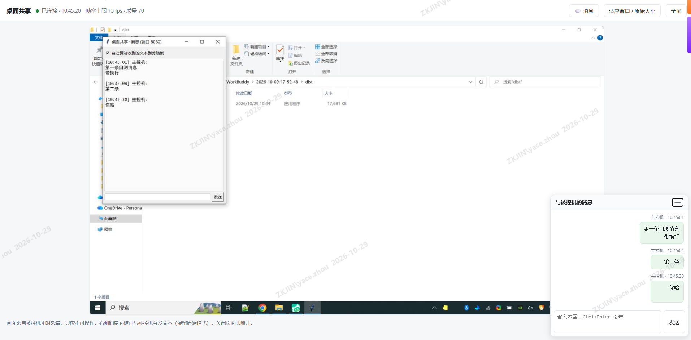

# WebScreenShare · 极简网页版桌面共享

[](https://github.com/ztommyc/web-screen-share/actions/workflows/build.yml)

GitHub：https://github.com/ztommyc/web-screen-share ｜ Gitee 镜像：https://gitee.com/ztommy/web-screen-share

被控机跑一个单文件程序，控制机用浏览器打开就能实时看桌面 —— **不用装 VNC、不用装任何客户端、不写注册表**。
附带**双向文本消息**（保持换行/缩进原样），适合远程排障、内网机画面查看、被管控环境下的轻量投屏。

## 特性

- **纯浏览器查看**：控制端零安装，打开 `http://<被控机IP>:8080/` 即可
- **MJPEG 实时流**：`multipart/x-mixed-replace`，兼容性极好，断线自动重连
- **双向文本消息**：浏览器 ↔ 被控机小窗互发，`pre-wrap` + 等宽字体，换行/缩进/Tab 原样保留
- **单文件 exe**：PyInstaller 打包，绿色运行，目标机不需要 Python
- **两种采集后端**：`mss`(GDI) / `dxcam`(DXGI)，抓到黑屏可一键切换
- **访问口令**：`--token`，URL 带 `?token=xxx`
- **可调参数**：帧率、JPEG 质量、缩放、指定显示器

## 界面截图

真实使用场景：浏览器实时画面（被控机桌面 + 置顶消息小窗）+ 右下角主控机消息面板，换行/缩进原样保留。



## 快速开始

### 方式零：直接下现成的 exe（Windows）

到 [Releases](https://github.com/ztommyc/web-screen-share/releases) 下载 `screen-share.exe`，拷到被控机双击即可，无需 Python。
每次打 `v*` tag，GitHub Actions 会自动构建并挂到 Release 上。

### 方式一：直接跑源码

```bash
pip install mss pillow
python screen-share.py --port 8080
```

### 方式二：打包成单文件 exe（拷到被控机即用）

```bash
pip install pyinstaller
pyinstaller --onefile screen-share.py
# 产物：dist/screen-share.exe
```

### 控制机访问

```
http://<被控机IP>:8080/
```

被控机启动时会把本机所有 IPv4 地址打印出来，直接照抄即可。

## 参数

| 参数 | 默认 | 说明 |
| --- | --- | --- |
| `--host` | `0.0.0.0` | 监听地址 |
| `--port` | `8080` | 端口 |
| `--fps` | `15` | 采集帧率（1-60） |
| `--quality` | `70` | JPEG 质量（1-95） |
| `--scale` | `0.75` | 画面缩放，降低带宽 |
| `--monitor` | `0` | 显示器序号，`0`=全部屏幕，`1`=主屏 |
| `--backend` | `mss` | 采集后端：`mss` / `dxcam` |
| `--token` | 空 | 访问口令 |
| `--no-ui` | 关 | 不弹被控端消息小窗 |

```bash
# 典型：限带宽 + 口令
screen-share.exe --port 8080 --fps 10 --quality 60 --scale 0.6 --token mypass
```

## 双向消息

- **浏览器端**：右下角消息面板，`Ctrl+Enter` 发送；面板可最小化成一条标题栏，收到消息 header 上显示未读角标
- **被控端**：桌面置顶小窗，回车发送；勾选「自动复制收到的文本到剪贴板」后，收到的内容可直接粘贴
- 格式保持：消息以原文存放与渲染（`textContent` + `white-space: pre-wrap`），不做 Markdown 解析、不丢空白
- 双击消息气泡可复制该条文本

## HTTP 接口

| 方法 | 路径 | 说明 |
| --- | --- | --- |
| GET | `/` | 查看页面 |
| GET | `/stream` | MJPEG 视频流（`fps`/`quality`/`scale` 可覆盖） |
| GET | `/snapshot.jpg` | 单帧截图 |
| GET | `/poll?after=<id>&wait=1` | 长轮询取新消息，`wait=1` 最长挂起 25s |
| POST | `/send` | 发送消息，body: `{"text":"..."}` |
| GET | `/health` | 健康检查 |

带 `--token` 时，所有请求都要在 query 里带 `token`。

```bash
curl -X POST -H "Content-Type: application/json" \
     -d '{"text":"hello"}' "http://127.0.0.1:8080/send?token=mypass"

curl "http://127.0.0.1:8080/poll?after=0&wait=1&token=mypass"
```

## 防火墙

Windows 首次运行会弹放行提示，或手动加规则：

```bat
netsh advfirewall firewall add rule name="WebScreenShare" dir=in action=allow protocol=TCP localport=8080
```

## 安全说明

- 画面是**只读**的：不做键鼠控制，只推 JPEG 帧
- 默认无口令，**公网暴露务必加 `--token`**，并配合防火墙限制来源 IP
- 流量是明文 HTTP，不要在不可信网络裸奔；需要加密请套 Nginx/FRP 的 TLS 反代
- 消息只存内存（默认保留最近 1000 条），进程退出即清空

## 许可

MIT License，见 [LICENSE](LICENSE)。
